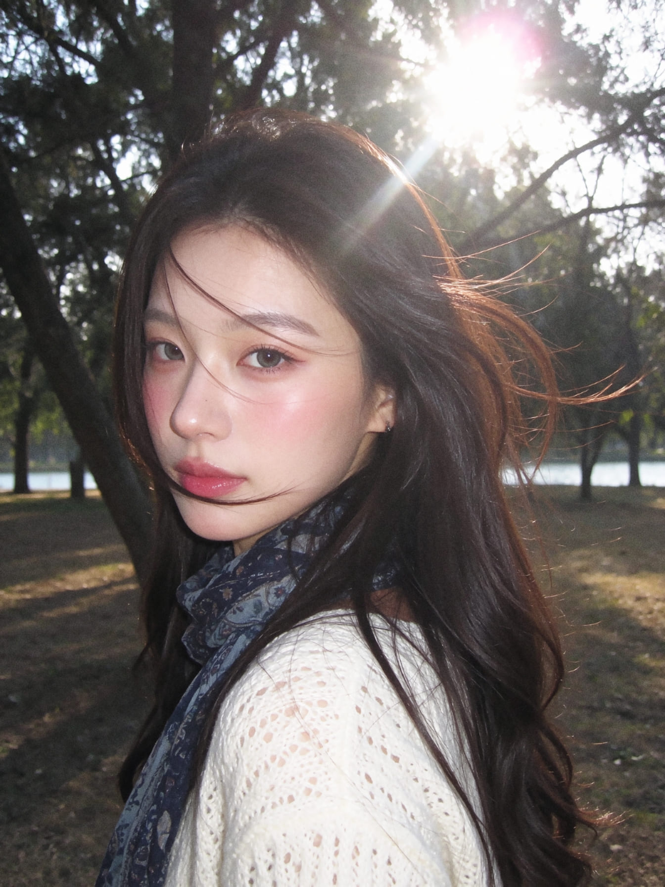
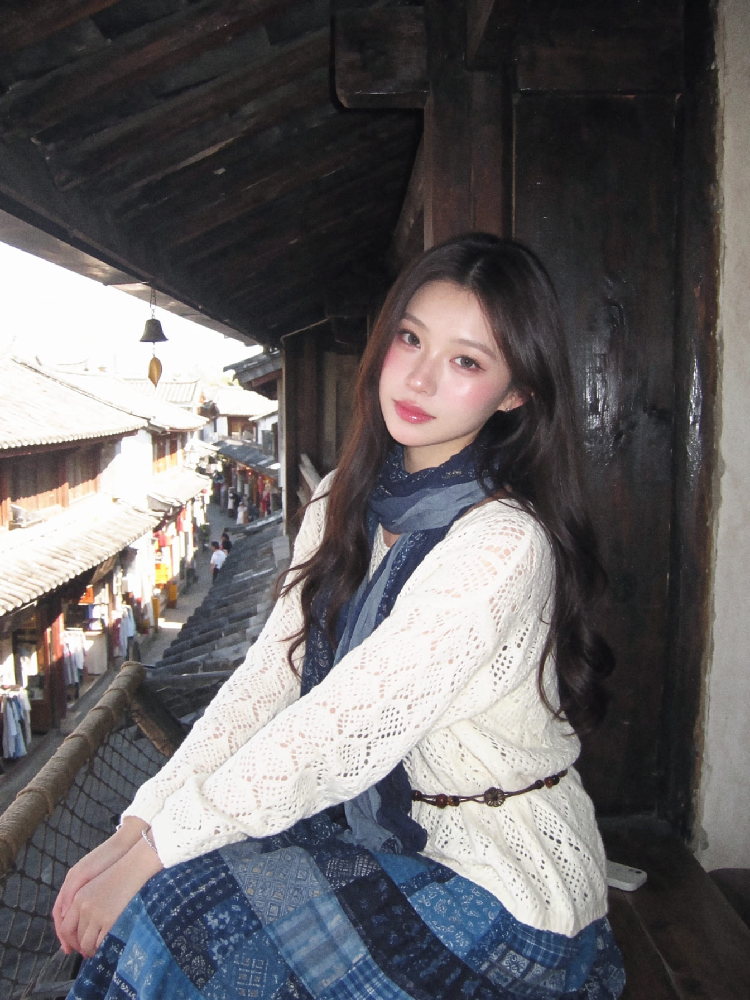
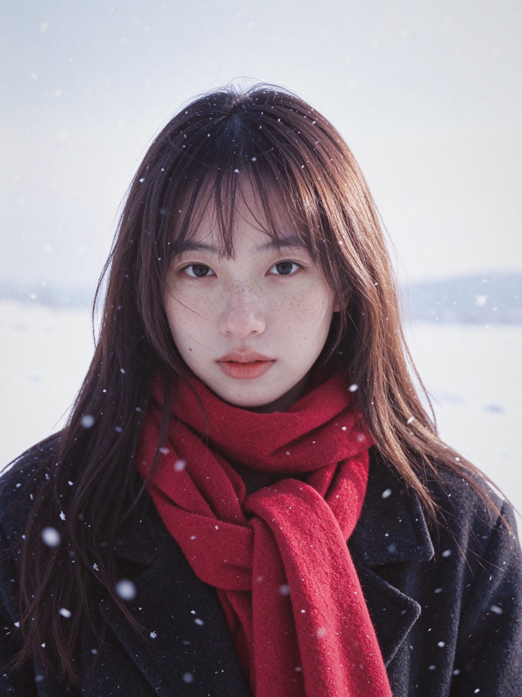
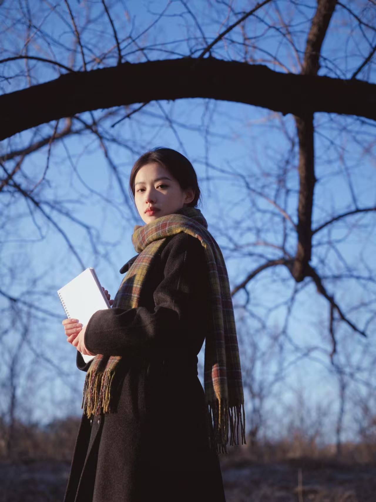

<div align="center">

# 西兰公园 · 照片模板

**把喜欢的风格，留在你的照片里。**

[浏览模板](#模板目录) · [使用方法](#使用方法) · [关注西兰公园](https://v.douyin.com/lr0WhPPv9G8/)

</div>

---

## 使用方法

首次使用，在豆包电脑端发送：

```text
豆包你好，帮我安装 GitHub 上 zihengl400-spec/xilan-photo-skill 的技能。安装完成后请只回复“安装完成，请上传照片并告诉我模板日期。”不要总结技能文件或介绍内部配置。
```

浏览某一天的预览：

```text
查看西兰公园 2026-11-10 的模板。
```

直接使用时，上传照片并发送：

```text
请使用西兰公园 2026-11-10 的模板 10，处理我上传的照片。
```

每次使用时，技能会检查仓库版本，并读取对应版本的最新模板。已安装技能的自动更新取决于安装方式和客户端权限；如提示更新或重启会话，请按提示操作。图片处理能力与预览展示效果也取决于客户端环境。

## 模板目录

### 2026-11-10

#### 模板 1 · 韩系街头近景


#### 模板 10 · 街头回眸


#### 模板 12 · 街头冰饮眨眼


#### 模板 14 · 复古店铺人像


### 2026-11-11

#### 模板 2 · 冬日树林回眸


#### 模板 3 · 古镇木楼写真 A


#### 模板 4 · 古镇木楼写真 B


模板 3 和模板 4 的预览图不同，配套的指令文本相同。

#### 模板 5 · 山林逆光自拍


#### 模板 6 · 冬日湖边写真


### 2026-11-12

#### 模板 1 · 雪后海边写真


#### 模板 2 · 树影光斑特写


#### 模板 3 · 雪野红围巾


#### 模板 4 · 胡同逆光围巾


#### 模板 5 · 冬日公园暖阳



---

<div align="center">

**原创：西兰公园**<br>
欢迎宝宝们在抖音关注我！<br>
[点击访问抖音主页](https://v.douyin.com/lr0WhPPv9G8/)

</div>
